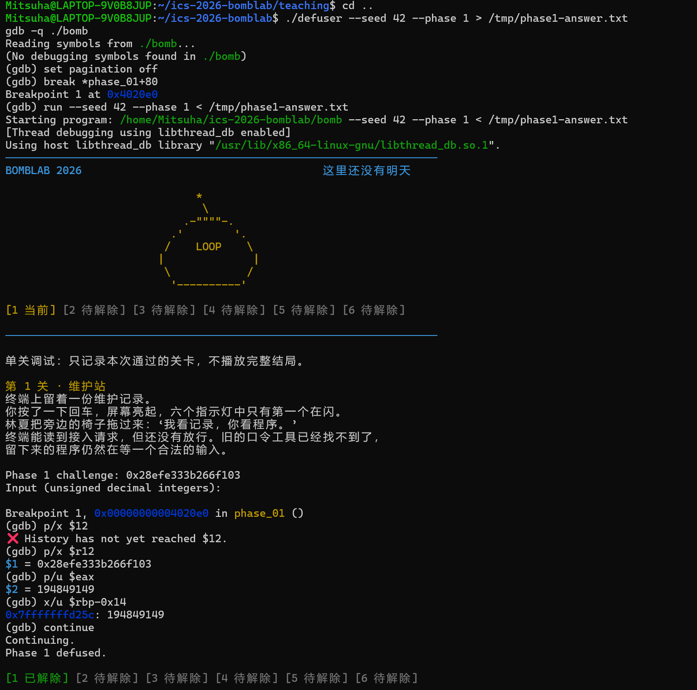
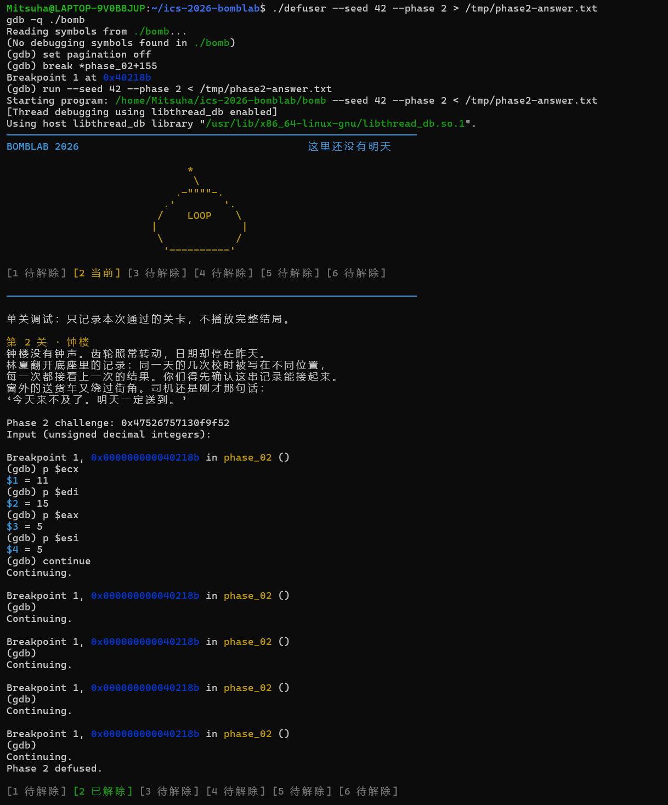
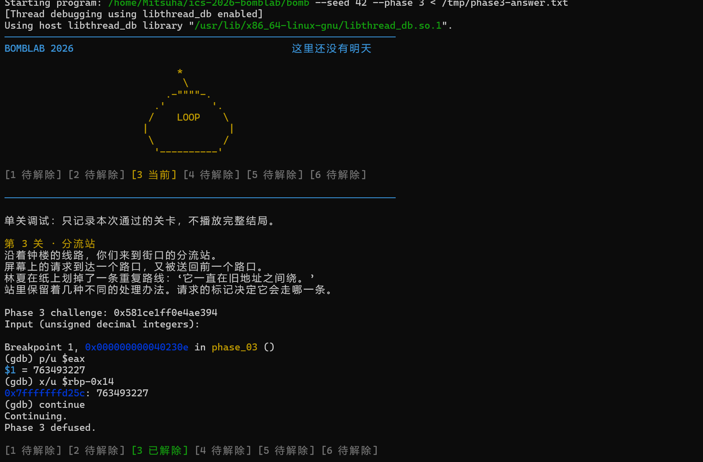
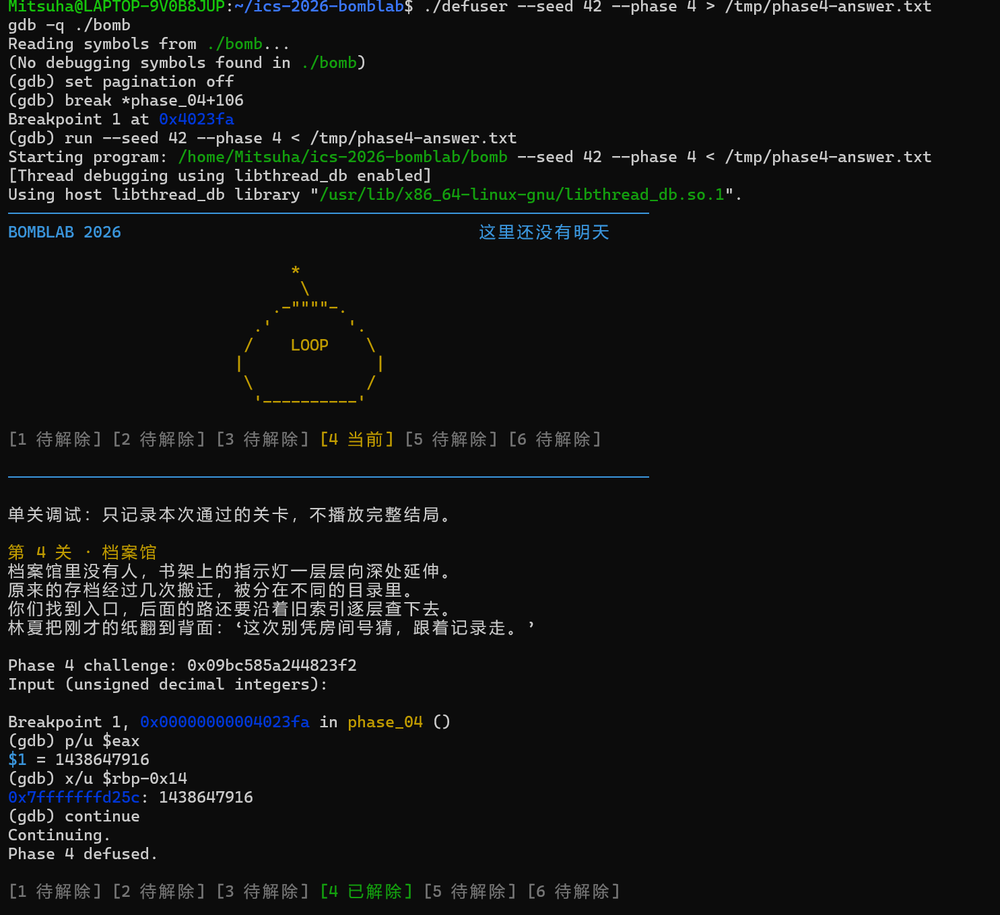
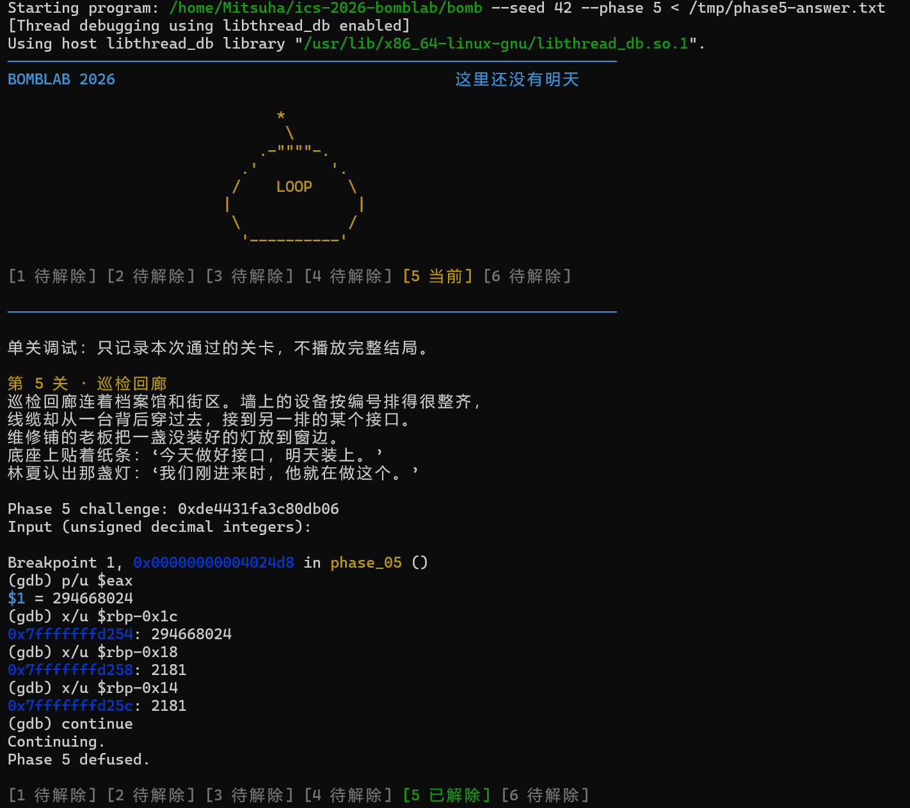
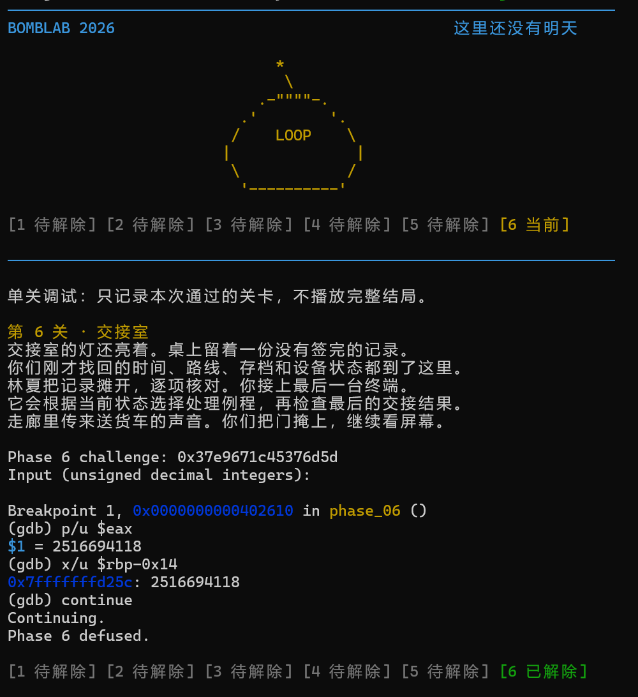

# BombLab 实验报告

> **提交前请核对：**本报告根据当前 `defuser.c`、本地实际测试记录和 `picture/1.png` 至 `picture/6.png` 整理。汇编分析与求解代码曾由 AI 助手协助推导和实现；请先自行复核并用自己的理解改写分析，再作为个人报告提交。文中只记录实际执行过的测试，没有编造试错数据。

## 1. 实验目的与方法

BombLab 的每个阶段都会根据 64 位 `challenge` 检查一行输入。解题不是记住某次运行的口令，而是从炸弹的 x86-64 汇编中恢复计算关系，并在 `defuser.c` 的求解函数中按 `challenge` 计算口令。

本次主要使用 GDB 反汇编和观察运行时寄存器，再用 C 的 `uint32_t` 运算复现 32 位计算。无符号 32 位运算溢出时按模 \(2^{32}\) 回绕，与相关机器指令的低 32 位结果一致。

## 2. 各阶段分析

### Phase 1：函数调用与算术

`phase_01` 使用 `sscanf` 读取一个无符号整数，调用 `p1_compute(challenge)`，然后比较计算结果和输入。`p1_compute` 从 challenge 的低、高 32 位及移位后的字段形成三个中间步骤：

设 `lo = (uint32_t)challenge`，`hi = (uint32_t)(challenge >> 32)`：

```text
s2 = 3 × (hi - lo) + 0x4ef2
s0 = 2 × lo + (((uint32_t)(challenge >> 16)) XOR 0xda66)
answer = (5 × s0) XOR (s2 + 0x35e1)
```

`lea` 指令在这里用于乘加（例如 `2*x+y`、`5*x`），`xor` 对应按位异或。所有中间计算以 32 位无符号数执行。

截图记录了 seed 42 下的 GDB 检查：炸弹的计算值和解析到的输入均为 `194849149`，随后显示 `Phase 1 defused.`。



### Phase 2：数组与递推循环

`phase_02` 读取六个整数。第一项取 challenge 的五位字段；后续五项由循环计算。反汇编中的 `ecx` 每轮加 2，作为 challenge 的位移量；`edi` 每轮加 `0xf`，再与当前计算值异或。循环状态更新说明每一项依赖前一项，而不是都依赖第一项。

```text
v[0] = (challenge >> 40) & 0x1f
对于 i = 0..4:
    nibble = (challenge >> (11 + 2*i)) & 0xf
    v[i+1] = (nibble + v[i]) XOR (15 * (i+1))
```

调试时曾有一次真实的推导错误：初版把每一项都加到 `v[0]` 上，Phase 2 公开测试为 `0/10`。在第二轮比较处，GDB 显示炸弹期望 `15`、初版求解器给出 `13`；据此改为使用前一项递推后通过测试。seed 42 的截图记录了循环比较过程和最终通过结果。



### Phase 3：分支与跳转表

`phase_03` 读取两个整数。第一个是跳转表索引，第二个要与跳转分支计算值相同：

```text
index = challenge & 7
x = (uint32_t)((challenge >> 3) XOR (challenge >> 32))
```

跳转表实际顺序不是 `p3_case_N` 符号名的顺序。根据表项地址，索引到公式的对应关系如下：

| 索引 | 计算第二个输入的公式 |
|---:|---|
| 0 | `(x XOR 0x964f) + (x >> 2)` |
| 1 | `5*x + 0xc5b7` |
| 2 | `(2*x) XOR 0xf130` |
| 3 | `5*x + 0x4d788` |
| 4 | `3*x + 0xc2c4` |
| 5 | `(2*x) XOR 0x2627` |
| 6 | `5*x + 0x2d71` |
| 7 | `(x XOR 0xe7f) + (x >> 1)` |

初次按函数符号名直接映射分支时，公开测试为 `2/10`。检查跳转表后发现索引与函数名顺序不同，按实际表项修正映射，之后公开测试通过。seed 42 对应的索引为 `4`，第二个整数为 `763493227`。



### Phase 4：递归与二分搜索

`phase_04` 读取一个整数，并调用递归函数在 `[0, 127]` 范围搜索目标。目标和递归搜索的中点相等时到达基例；否则走左或右区间。每层返回时将递归结果乘 3、与当前中点和 salt 组合，再按方向异或不同常数。

```text
target = challenge & 0x7f
salt = (uint32_t)((challenge >> 7) XOR (challenge >> 32))
mid = low + ((high - low) >> 1)

若 target == mid:
    return (mid + 0xb5) XOR salt
若 target < mid:
    r = walk(target, low, mid - 1, salt)
    return (3*r XOR (mid + salt)) XOR 2
否则:
    r = walk(target, mid + 1, high, salt)
    return (3*r XOR (mid + salt)) XOR 0x1d
```

递归调用对应函数的 `call`，返回值再经 `lea`（乘 3）、`xor` 和 `ret` 逐层组合。截图中 seed 42 的答案及炸弹计算结果均为 `1438647916`。



### Phase 5：结构体布局与链表遍历

节点可以按以下字段理解：`next` 指针位于偏移 `0`，32 位节点值位于偏移 `8`，32 位 salt 位于偏移 `12`。`p5_heads` 是八个链表头指针的表。汇编先由 challenge 选择表头，再按 challenge 提供的跳数遍历；每访问一个节点，就更新累积值，并保留最后访问节点的值。

```text
head_index = challenge & 7
hops = (challenge >> 3) & 3
acc = (uint32_t)((challenge >> 6) XOR (challenge >> 32))

首节点:
    acc = (5 * ((acc XOR 0x30a9) + salt) XOR value)
后续每个节点:
    acc = (5 * (acc + salt) XOR value)
```

最终输入包含两个整数：累积值和最后访问节点的值。分析结构体时，`mov (%rdx)` 读取 `next`，`mov 8(%rdx)` 读取节点值，`add 0xc(%rdx)` 读取并累加 salt。

seed 42 的截图记录了两个字段的比较：累积值 `294668024`，最后节点值 `2181`，均与输入一致。



### Phase 6：函数指针表与间接调用

`p6_dispatch` 从 challenge 中取出两组 3 位索引。两次 `call *...` 是通过函数指针表执行间接调用：第一次计算中间值并与 `0xdab8` 异或，第二次以中间值调用另一运算，最后加 `0x495b`。

```text
i1 = challenge & 7
i2 = (challenge >> 3) & 7
x = (uint32_t)((challenge >> 6) XOR (challenge >> 32))
tmp = op[i1](x) XOR 0xdab8
answer = op[i2](tmp) + 0x495b
```

从 `p6_ops` 表中读出的函数顺序是：

| 表索引 | 实际运算 |
|---:|---|
| 0 | `(x XOR 0x285b) + 8*x` |
| 1 | `((x >> 3) XOR x) + 0x176b` |
| 2、5 | `(x + 0xa0f2) XOR (x >> 1)` |
| 3、6 | `ROL32(x, 2) XOR 0x1ad6` |
| 4 | `(8*x + 0x6b58) XOR 7*x` |
| 7 | `ROR32(x, 2)` |

截图中的 seed 42 验证结果为 `2516694118`，与输入一致。



### Honor / Secret

Secret 输入通过前六关答案形成的 `context` 和 Secret 的 `challenge` 共同计算。`secret_phase` 读取三个无符号整数，并依次比较：

```text
c = context & 3
challenge_mix = low32(challenge) XOR high32(challenge)
context_mix = low32(context) XOR high32(context)
second = secret_mix(challenge_mix XOR context_mix)
         XOR (c * 0x145f)
         XOR low32(context >> 16)
third = second XOR (context_mix + c + 0xad48 + (challenge_mix >> 3))
```

其中 `secret_mix(x) = (5*x + 0x145f) XOR 0xad48`。此外，`secret_gate` 检查输入字符串偏移 32 处是否为 `OPEN`，因此输出行在标记前需要 32 个空格，再跟随三个十进制整数。报告截图没有包含 Secret 画面；Secret 的运行结果由下面的完整 transcript 测试和公开 Honor 测试记录验证。

## 3. 测试与试错记录

### 实际试错与修正

| 阶段 | 观察到的问题 | 修正依据 |
|---|---|---|
| Phase 2 | 初版将每一项都与第一项相加，公开测试 `0/10`；GDB 第二轮期望 `15`，输入为 `13`。 | 根据循环寄存器和比较结果确认应使用前一项，改为递推。 |
| Phase 3 | 初版按 `p3_case_N` 名称映射跳转，公开测试 `2/10`。 | 读取跳转表项地址，按真实索引顺序修正分支。 |
| Secret | 初版将 `OPEN` 放在行首，Secret gate 未通过。 | GDB 检查 gate 的缓冲区偏移，确认 `"OPEN"` 应出现在偏移 32。 |

这些是实际调试过程中观察到的失败与修正，不是虚构的实验数据。

### 测试结果

使用 `make defuser` 编译，编译成功。`python3 public_test.py --phase N` 对每个常规阶段执行 `tests/public.json` 中的 10 个 seed；每阶段均为 `10/10 PASS`。`python3 public_test.py --secret` 的 Honor 测试为 `10/10 PASS`。

另使用公开列表之外的 seed `3141592653`，分别运行 Phase 1–6 和完整 Secret transcript，所有阶段均通过。

seed 42 的截图均为单关 GDB 验证，画面显示相应计算值与输入值一致，并显示该关 `defused`。seed 42 属于公开 seed；额外 seed `3141592653` 的结果来自本次额外测试，但没有对应截图。

## 4. 使用的工具与参考资料

- **GDB**：对 `bomb` 进行反汇编，检查分支、跳转表、递归、数据布局和运行时比较值。
- **GCC / Make**：使用项目提供的 `Makefile` 编译，并启用 `-Wall -Wextra -Wpedantic -Werror`。
- **项目测试程序**：运行 `public_test.py --phase N` 和 `public_test.py --secret`。
- **AI 助手**：协助阅读汇编、推导公式、编写求解实现和执行测试。解法由 AI 协助生成；提交者应自行理解、复核并按照课程要求如实说明，不应将 AI 生成的分析伪装成独立完成的过程。
- **项目说明**：[README.md](./README.md) 与仓库中的 `tests/public.json`。
